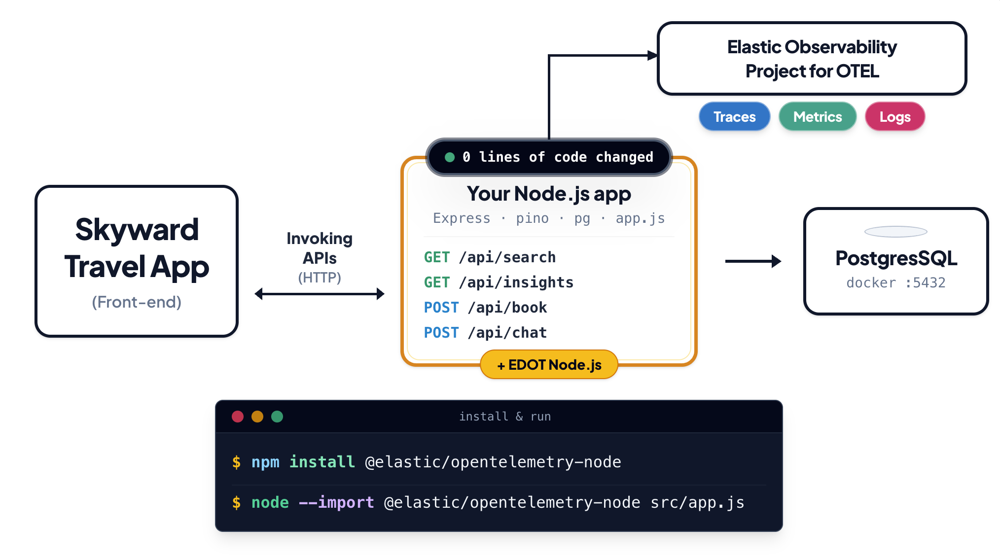

# Skyward for Business — Node.js observability demo with Elastic

[](https://codespaces.new/suyashcjoshi/elastic-observability-nodejs-demo?quickstart=1)
[](https://www.elastic.co/docs/reference/opentelemetry/edot-sdks/node)
[](https://nodejs.org)
[](LICENSE)

A Node.js flight search app with four bugs on purpose. Use Elastic Observability to find each one, fix it, and watch the app get better.

The app has no OpenTelemetry code. Elastic gets its data from one startup flag:

```sh
node --import @elastic/opentelemetry-node src/app.js
```

That command (what `npm start` runs) starts only the app. To start Postgres and the partner mocks, run `npm run services`. To start everything including the app, run `npm run dev`.

**You need:** Node.js 20.12+ and Docker.

> **This is a learning demo.** The slow code is on purpose. Don't copy it into a real service. Request inputs are not validated.
>
> **Want the bug-free version?** Check out the [`fixed`](../../tree/fixed) branch: same app, none of the four bugs.
>
> **Using an AI coding tool?** Point it at [AGENTS.md](AGENTS.md).

## Architecture



## The four problems

| What you see | Cause | Where to look in Elastic | Fix |
|---|---|---|---|
| Search takes about 5 seconds | `CHAOS_STAIRCASE`: the four partners (1.3 s each) are called one after another | Trace waterfall shows a staircase of four HTTP spans | `CHAOS_STAIRCASE=false` (calls run in parallel, about 1.3 s) |
| Chat answers "Sorry, I couldn't load your recent searches" | Missing `await` on `pool.query()` in `/api/chat`. The `TypeError` is caught and the endpoint returns a 200 fallback with `degraded: true`, so the browser console is empty | Errors tab and logs show a `TypeError` pointing at the line; it is only in server logs | Add `await` |
| App feels frozen, chat says "Still connecting..." | `CHAOS_GAP`: slow duplicate-removal blocks the event loop | `/health` takes ~700 ms with no child spans; `nodejs.eventloop.delay` spikes | `CHAOS_GAP=false` (faster Map-based version) |
| Booking fails with a request ID (needs `PENGUIN_DEGRADED=true`) | `CHAOS_PARTNER`: no timeout on Penguin Air, which is slow and sometimes returns 503 | Dependencies view shows Penguin Air in red; error traces link to logs | `CHAOS_PARTNER=false` (1.5 s timeout and fallback) |

`PENGUIN_DEGRADED` is `false` by default so search shows the staircase problem on its own. Set `PENGUIN_DEGRADED=true` in `.env` and restart `npm run services` to switch on the Penguin Air scenario.

## Quick start

**You need:** Node.js 20.12+ and Docker. An Elastic Cloud project is only needed for step 2.

### 1. Start Postgres and the partner mocks

```bash
git clone https://github.com/suyashcjoshi/elastic-observability-nodejs-demo
cd elastic-observability-nodejs-demo
npm install
cp .env.example .env
npm run services     # starts Postgres, seeds it, starts the four partner mocks (no app)
```

`.env` holds only app and partner settings. Elastic settings are never put in `.env`.

### 2. Connect to Elastic and start the app

1. No Elastic account? Start a free trial at [cloud.elastic.co/registration](https://cloud.elastic.co/registration) and choose **Serverless → Observability**.
2. In your project, open **Add data → Application → OpenTelemetry** and copy the endpoint and API key.
3. Export them in your shell (the SDK reads them at startup, so they must be set before the app starts):

   ```bash
   export OTEL_EXPORTER_OTLP_ENDPOINT="https://<your-project>.ingest.<region>.elastic.cloud:443"
   export OTEL_EXPORTER_OTLP_HEADERS="Authorization=ApiKey <your-api-key>"
   export OTEL_SERVICE_NAME="skyward-travel-app"
   ```

4. Start the app:

   ```bash
   npm start
   ```

   `npm start` is exactly this command:

   ```bash
   node --import @elastic/opentelemetry-node src/app.js
   ```

5. Open http://localhost:3000, click Search (LHR → SFO is pre-filled), then run `npm run verify` (prints PASS). After a minute, the app shows up under **Observability → Services**.

In a Codespace, click the badge at the top instead. The app is ready on port 3000 in about two minutes.

### 3. Fix one problem at a time

Change one `CHAOS_*` flag in `.env`, restart the app (`npm run restart:elastic`), search again, and compare in Kibana.

To compare side by side, start everything with the buggy app on :3000 and the fixed app on :3001, then open http://localhost:3000/compare.html:

```bash
npm run dev:compare        # partners + buggy app :3000 + fixed app :3001
```

Or run the pieces yourself:

```bash
npm run start:fast         # fixed app on :3001
npm run load               # load test :3000 (slow)
npm run load:fast          # load test :3001 (fixed)
```

## Useful commands

| Command | What it does |
|---|---|
| `npm run services` | Start Postgres (seeded) and the partner mocks, not the app |
| `npm run dev` | Start everything (Postgres, partners, app) |
| `npm run dev:compare` | Start everything plus the fixed app on :3001 (side-by-side at `/compare.html`) |
| `npm run verify` | Check all endpoints |
| `npm run stop:all` | Stop the app, partners and Postgres |
| `npm test` | Run smoke tests |

To run with Docker instead: `docker compose up -d` (and `docker compose down` to stop).

## Learn more

- [EDOT Node.js setup](https://www.elastic.co/docs/reference/opentelemetry/edot-sdks/node/setup)
- [Quickstart: monitor application performance](https://www.elastic.co/docs/solutions/observability/get-started/quickstart-monitor-your-application-performance)
- No cloud account? Run Elastic locally: `curl -fsSL https://elastic.co/start-local | sh -s -- --edot`

## License

Apache-2.0. See [LICENSE](LICENSE).
