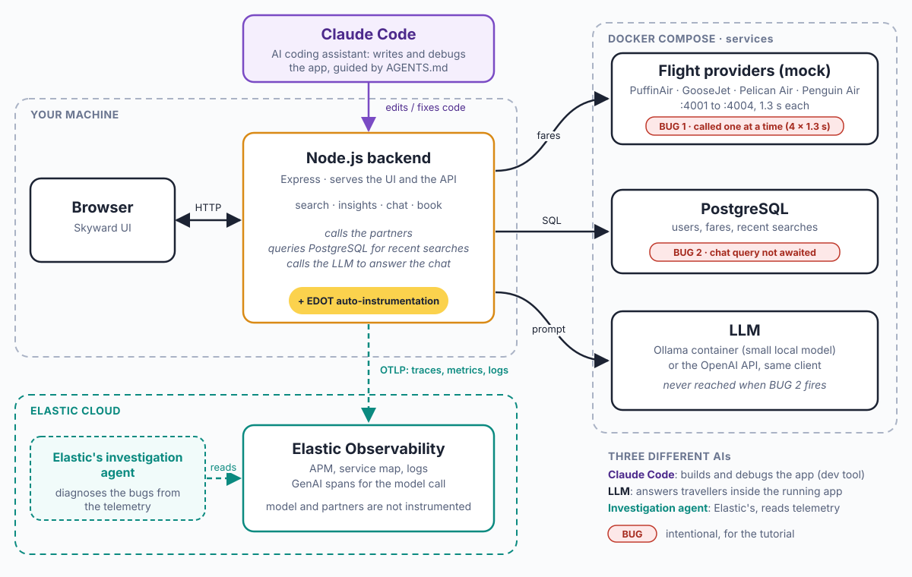

# Skyward Travel App — Node.js observability tutorial with Elastic

[](https://codespaces.new/suyashcjoshi/elastic-observability-nodejs-demo?quickstart=1)
[](https://www.elastic.co/docs/reference/opentelemetry/edot-sdks/node)
[](https://nodejs.org)
[](LICENSE)

A Node.js flight-search app with an LLM-backed travel chatbot and **two bugs on purpose**. Use Elastic Observability to find each one, fix it, and watch the app get better.

The application source contains no OpenTelemetry code. Elastic gets traces, metrics and logs from one startup flag, `--import @elastic/opentelemetry-node` (EDOT Node.js). That flag also auto-instruments the `openai` client, so the chatbot's model call shows up as a GenAI span with no extra code.

> **This is a learning demo.** The slow and broken code is on purpose. Don't copy it into a real service. The demo user is a random number from 1 to 10 chosen in the browser, with no authentication.
>
> **Using an AI coding tool?** Point it at [AGENTS.md](AGENTS.md).

## Architecture



| Hop | What happens |
|---|---|
| Browser → Node.js backend | The UI calls `/api/search`, `/api/insights`, `/api/chat`, `/api/book` |
| Backend → four mock providers | `/api/search` fetches fares from PuffinAir, GooseJet, Pelican Air, Penguin Air (1.3 s each) |
| Backend → PostgreSQL | Recent searches for the chat user are the **retrieved context** (search history only; there is no chat-message history or booking table) |
| Backend → LLM provider | `/api/chat` builds a prompt from the question, the retrieved searches and demo policy facts, then calls an OpenAI-compatible Chat Completions endpoint (a small local Ollama model by default, or OpenAI) |
| Backend → Elastic | EDOT sends traces, metrics and logs over OTLP |

**Three different "AIs":** the *app's LLM* answers travellers in the chat widget. *Elastic's investigation agent* is a feature of Elastic Observability that reads the telemetry to help you diagnose problems. *Claude Code* is the AI coding assistant used to write and debug this app (it follows [AGENTS.md](AGENTS.md)); it is a development tool and is not part of the running system. They are unrelated; this repo only builds the first.

In the diagram, your machine runs the browser and the Node.js backend (`npm start`), Docker Compose runs the partners, PostgreSQL and the local model (`npm run services`), and telemetry goes to Elastic Cloud. The red tags mark the two intentional bugs.

## The two default bugs

| What you see | Cause | Where to look in Elastic | Fix |
|---|---|---|---|
| Search takes about 5.2 s | `CHAOS_STAIRCASE`: the four partners (1.3 s each) are called one after another | Trace waterfall shows a staircase of four HTTP spans | `CHAOS_STAIRCASE=false` (`Promise.allSettled`, about 1.3 s) |
| Chat says "Sorry, I couldn't load your recent searches" | `CHAOS_CHAT`: `/api/chat` calls `pool.query()` without `await`, so `history.rows` is `undefined` and a `TypeError` is thrown before the model is called | Errors/logs show the `TypeError` with the request ID; the trace has a database span and **no model span** | `CHAOS_CHAT=false` (adds the `await`) |

**HTTP 200 does not mean success.** The broken chat returns `200` with `degraded: true` on purpose. Dashboards that only count 5xx would report the endpoint healthy while every chat fails. The browser console is clean; only server-side logs and traces show the error. This is the point of the exercise.

The two flags are independent: fixing search does not change chat, and the other way round. `ENABLE_CHAOS=false` forces both off. Partners never fail at random; every partner simply takes 1.3 s, which is the latency the search trace shows. Booking works normally.

## Setup

You need an Elastic Cloud project ([free trial](https://cloud.elastic.co/registration): choose **Serverless → Observability**) and **Docker**. Node.js 20.12+ is needed unless you run everything in containers. Every path follows the same six steps: install, configure, start services, start the instrumented app, generate traffic, verify telemetry.

### Path A (recommended): Docker for the dependencies, app on your machine

`npm run services` starts PostgreSQL, the four partner mocks and the Ollama chat model in Docker Compose. The app runs on your machine, so switching scenarios is a one-line command.

1. **Install:**
   ```bash
   git clone https://github.com/suyashcjoshi/elastic-observability-nodejs-demo
   cd elastic-observability-nodejs-demo
   npm install
   ```
2. **Configure:** `cp .env.example .env`, then set `OTEL_EXPORTER_OTLP_ENDPOINT` and `OTEL_EXPORTER_OTLP_HEADERS` (`Authorization=ApiKey <key>`). In your Elastic project: **Add data → Application → OpenTelemetry**. Nothing else needs changing. (To use OpenAI instead of the local model, uncomment `OPENAI_API_KEY` and `OPENAI_MODEL`.)
3. **Start services:**
   ```bash
   npm run services
   ```
   The first run downloads the chat model (`qwen2.5:1.5b`, about 1 GB, a few minutes); later runs reuse it.
4. **Start the instrumented app:**
   ```bash
   npm start      # node --env-file=.env --import @elastic/opentelemetry-node src/app.js
   ```
   Open http://localhost:3000. (`npm run dev` runs steps 3 and 4 together, with the app in the background.)
5. **Generate traffic:** click **Search flights** (LHR → SFO is pre-filled), open the chat bubble and ask "Is a fare of $1,100 in policy?", then book a flight. Or:
   ```bash
   npm run verify    # checks every endpoint against the active scenarios; exits 0 on success
   npm run load      # sustained traffic (LOAD_CHAT_RATE=0 skips chat)
   ```
6. **Verify telemetry:** see [Inspecting the model call in Elastic](#inspecting-the-model-call-in-elastic).

Stop with `npm run stop:all` (stops the app and removes the containers; the downloaded model is kept in a Docker volume).

### Path B: everything in containers

No Node.js needed. `cp .env.example .env`, set the Elastic `OTEL_*` values, then:

```bash
docker compose up -d --build
```

This starts PostgreSQL, the partners, Ollama, the default app on **:3000** (both bugs on) and the all-fixed app on **:3001**. Wait until `docker compose ps -a` shows `ollama-pull` as `Exited (0)` (the first start downloads the model). Open http://localhost:3000 or the side-by-side page http://localhost:3000/compare.html. `docker compose down` stops everything (`-v` also deletes the model). Compose does not forward variables exported in your shell, so settings must be in `.env`. The containers always use the Ollama container; to use OpenAI use Path A. GitHub Codespaces (the badge at the top) also runs Ollama in a container; the model downloads in the background on first start.

**Choosing a model.** The default `qwen2.5:1.5b` is about 1 GB. Set `LOCAL_MODEL=qwen2.5:0.5b` (about 400 MB, less accurate) in `.env` for a smaller download; the app and the model download both read it.

**How configuration reaches EDOT.** EDOT reads `OTEL_*` once, when `node` starts, before any application code. Node loads `--env-file` *before* the `--import` preload, so everything in `.env` is visible to the SDK. A variable exported in your shell wins over `.env`. The app itself never reads `.env`. Compose does the same through `env_file`, which fills the container environment before `node` starts. Don't commit `.env`.

After about a minute the app appears under **Observability → Applications → Service inventory** as `skyward-travel-app` (menu names vary by Kibana version).

## Scenarios

Shell variables override `.env`, so you can switch scenarios without editing it. Run each in a fresh `npm start` (Path A):

| Scenario | Command | Search | Chat |
|---|---|---|---|
| **Before** (default recording) | `npm start` | sequential, ~5.2 s | `TypeError`, 200 degraded |
| **Search-only fixed** | `CHAOS_STAIRCASE=false npm start` | concurrent, ~1.3 s | still broken |
| **Chat-only fixed** | `CHAOS_CHAT=false npm start` | still sequential | real model answer |
| **All fixed** | `ENABLE_CHAOS=false npm start` | concurrent | real model answer |

Side by side, each with its own service name in Elastic:

```bash
npm run dev:compare        # partners + before on :3000 + all-fixed on :3001; open http://localhost:3000/compare.html
npm run start:fast         # all fixed, :3001, service skyward-travel-app-fixed
npm run start:search-fixed # :3002, service skyward-travel-app-search-fixed
npm run start:chat-fixed   # :3003, service skyward-travel-app-chat-fixed
```

`npm start` alone only starts the :3000 app. The compare page needs the second app on :3001 as well: `npm run dev:compare` starts both, or run `npm start` and `npm run start:fast` in two terminals. The page labels each pane with the bugs that server reports as active (`GET /api/mode`); if a server isn't running, the label says which command starts it and the pane loads by itself once it is up. Under Path B only the before (:3000) and all-fixed (:3001) apps are provided.

## Inspecting the model call in Elastic

1. Open a `POST /api/chat` transaction from a **chat-fixed** run (`CHAOS_CHAT=false`).
2. In the waterfall you should see the `pg.query` database span and a client span named `chat <model>` (for example `chat qwen2.5:1.5b`) in the same trace. A plain outbound `POST` HTTP span also appears; the `chat <model>` span is the one produced by the GenAI instrumentation.
3. Open the `chat <model>` span. Its attributes include `gen_ai.operation.name` (`chat`), `gen_ai.system` (`openai`), `gen_ai.request.model`, `gen_ai.request.max_tokens`, `gen_ai.response.model`, `gen_ai.response.finish_reasons`, and `gen_ai.usage.input_tokens` / `gen_ai.usage.output_tokens`. Token usage only appears when the provider returns it. `gen_ai.system` reads `openai` even with Ollama, because it names the client library's API, not the server.
4. **The broken chat request has no model span.** It fails with a `TypeError` before the model call, so its trace contains only the HTTP server span and the database span. That absence is the symptom.
5. Prompt and response text is **off by default**. Setting `OTEL_INSTRUMENTATION_GENAI_CAPTURE_MESSAGE_CONTENT=true` in `.env` emits it as log events (`gen_ai.system.message`, `gen_ai.user.message`, `gen_ai.choice`) correlated to the span. The demo data is synthetic, but the prompt contains the user's search history and question, so enable it only for demos.

Compatibility: `@elastic/opentelemetry-node` 1.19.0 bundles `@opentelemetry/instrumentation-openai` 0.21.0, which supports `openai` `>=4.19.0 <7`. This repo pins `openai` `^6`. Elastic's published docs list an older range (`<6`) and say ESM support is limited, so we tested the combination: with ESM `import OpenAI from 'openai'` on Node 24, the Chat Completions span is produced with the attributes above.

## Reliability notes

- **Chat failure states are explicit.** History problems and model problems are separate: a model timeout is `504 llm_timeout`, a provider error or an unreachable model server (for example Ollama not started) is `502 llm_error`, a database failure is `503 history_unavailable`. Responses never carry a `reply` when the model did not answer, and server logs tag `failure: history_access` or `failure: llm`.
- **Bounded model calls.** `LLM_TIMEOUT_MS` (30 s in `.env.example`, which leaves room for a small local model on CPU), no retries, `LLM_MAX_OUTPUT_TOKENS` (300).
- **Small models are weaker.** We tried two: `qwen2.5:0.5b` (398 MB) answers in a few hundred milliseconds on CPU but gets facts wrong (it dropped the checked bag and mixed up the cancellation rule); `qwen2.5:1.5b` (986 MB, 1-2 s per answer) was noticeably more accurate on our five test questions, though it still slips occasionally. Either is fine for demonstrating traces. For better answers use a larger model or OpenAI.
- **Grounded answers.** The prompt supplies only the user's recent searches and a short list of synthetic Northwind policy facts, and tells the model it has no live airline access. Search history is the only retrieved context; there are no embeddings, vector search or stored conversations.
- **Per-partner timeouts.** Each partner call gets its own 4 s timeout (`PARTNER_TIMEOUT_MS`), so a sequential run never shares one clock.

## Known limitations

- **Small-model accuracy.** The default model is tiny on purpose. Expect an occasional wrong or invented detail; the first answer after startup is slow while the model loads.
- **Service map.** Ollama and the partners are not instrumented, so they are not services of their own; at most they appear as external dependencies of `skyward-travel-app`, inferred from client spans.
- **Tested versions.** Telemetry attribute names above come from `@opentelemetry/instrumentation-openai` 0.21.0 (via EDOT 1.19.0) and may change in newer releases.
- **Not a production pattern.** No authentication, the demo user is random, and the retrieved context is only recent search history.

## Tests

```bash
npm test                 # 44 tests; starts and seeds Postgres itself (needs Docker). Partner ports 4001-4004 must be free: run `docker compose stop partners` first if `npm run services` is up
npm run test:live-llm    # optional: one call to your configured real model (local Ollama by default, or OpenAI)
```

`npm test` uses a mocked or local fake model, so CI never makes a paid call. See `test/` for the unit tests (`chat`, `search`) and the integration test (`smoke`).

## Useful commands

| Command | What it does |
|---|---|
| `npm run services` | Docker Compose: Postgres (seeded), partner mocks and the Ollama model; not the app |
| `npm start` | Start the instrumented app on :3000 |
| `npm run dev` / `npm run dev:compare` | Services + app / services + before and after side by side |
| `npm run verify` | Check all endpoints against the active scenarios |
| `npm test` | Run the test suite |
| `npm run stop:all` | Stop the app and remove the containers (the model volume is kept) |
| `docker compose up -d --build` | Everything in containers, including the chat model |

## Learn more

- [EDOT Node.js setup](https://www.elastic.co/docs/reference/opentelemetry/edot-sdks/node/setup)
- [Quickstart: monitor application performance](https://www.elastic.co/docs/solutions/observability/get-started/quickstart-monitor-your-application-performance)
- No cloud account? Run Elastic locally: `curl -fsSL https://elastic.co/start-local | sh -s -- --edot`

## License

Apache-2.0. See [LICENSE](LICENSE).
